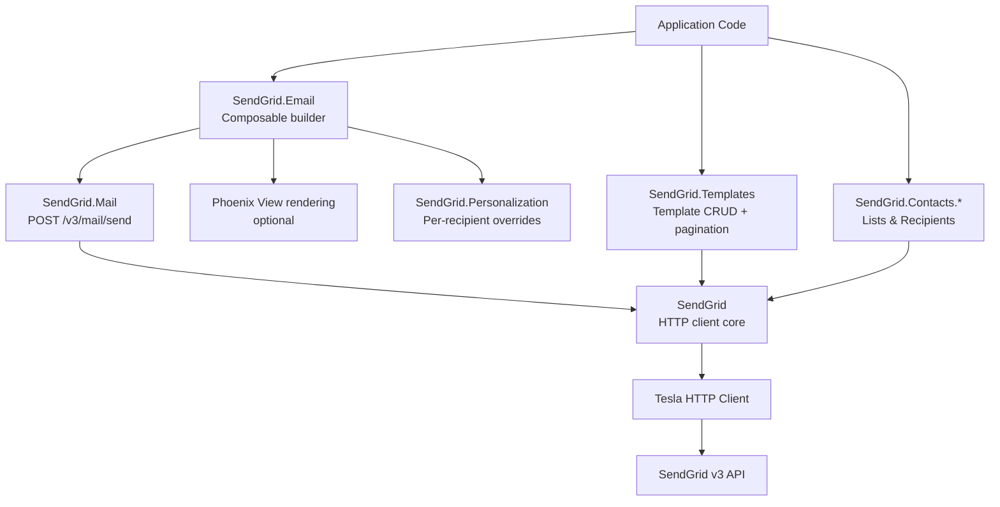

# Project Architecture

## Overview

`noizu_sendgrid` is an Elixir wrapper around the SendGrid v3 REST API. It provides a composable email builder (`SendGrid.Email`), a transactional mail sender (`SendGrid.Mail`), template management (dynamic and legacy), and marketing campaign contact/list operations. HTTP communication is handled by Tesla with JSON encoding via Jason.

## System Diagram

## Core Components

| Component | Module | Purpose |
|-----------|--------|---------|
| HTTP Client | `SendGrid` | Tesla-based GET/POST/PATCH/DELETE with API key management |
| Email Builder | `SendGrid.Email` | Struct + composable functions for building emails |
| Mail Sender | `SendGrid.Mail` | Sends composed emails via `/v3/mail/send` |
| Personalization | `SendGrid.Personalization` | Per-recipient overrides (to/cc/bcc, subject, headers, dynamic data) |
| Response | `SendGrid.Response` | Normalized response struct (body, headers, status) |
| Templates | `SendGrid.Templates` | Template CRUD, listing with pagination |
| Template Types | `SendGrid.DynamicTemplate`, `SendGrid.LegacyTemplate` | Type-specific template structs dispatched via `SendGrid.Template` |
| Template Versions | `SendGrid.Template.Version`, `SendGrid.Template.Versions` | Version management for templates |
| Contact Lists | `SendGrid.Contacts.Lists` | Marketing campaign list CRUD and recipient management |
| Recipients | `SendGrid.Contacts.Recipients` | Add contacts for marketing campaigns |

## Key Design Decisions

- **Composable builder pattern**: `Email` uses a pipeline-friendly API (`Email.build() |> Email.add_to(...) |> ...`) rather than a constructor with many arguments.
- **Jason.Encoder protocols**: `Email`, `Personalization`, and template structs implement `Jason.Encoder` to strip nil fields before serialization, keeping payloads clean.
- **Template dispatch via pattern matching**: `SendGrid.Template.new/2` pattern-matches on the `"generation"` field to return either `DynamicTemplate` or `LegacyTemplate`.
- **Optional Phoenix integration**: Email content can be rendered from Phoenix views/templates; the dependency is optional and only loaded in test.
- **Runtime API key resolution**: Supports both compile-time strings and `{:system, "ENV_VAR"}` tuples for twelve-factor config.

## Technology Stack

| Layer | Choice |
|-------|--------|
| Language | Elixir ~> 1.4 |
| HTTP | Tesla ~> 1.2 |
| JSON | Jason ~> 1.1 |
| Templates | Phoenix ~> 1.6 (optional, test only) |
| Config key | `:noizu_sendgrid` |
